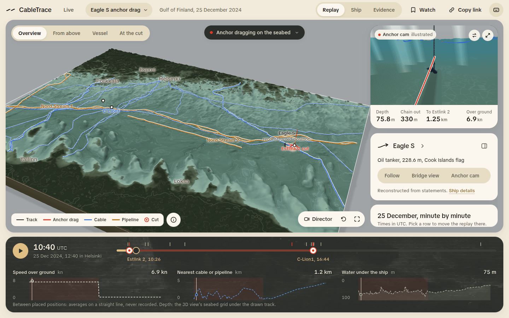
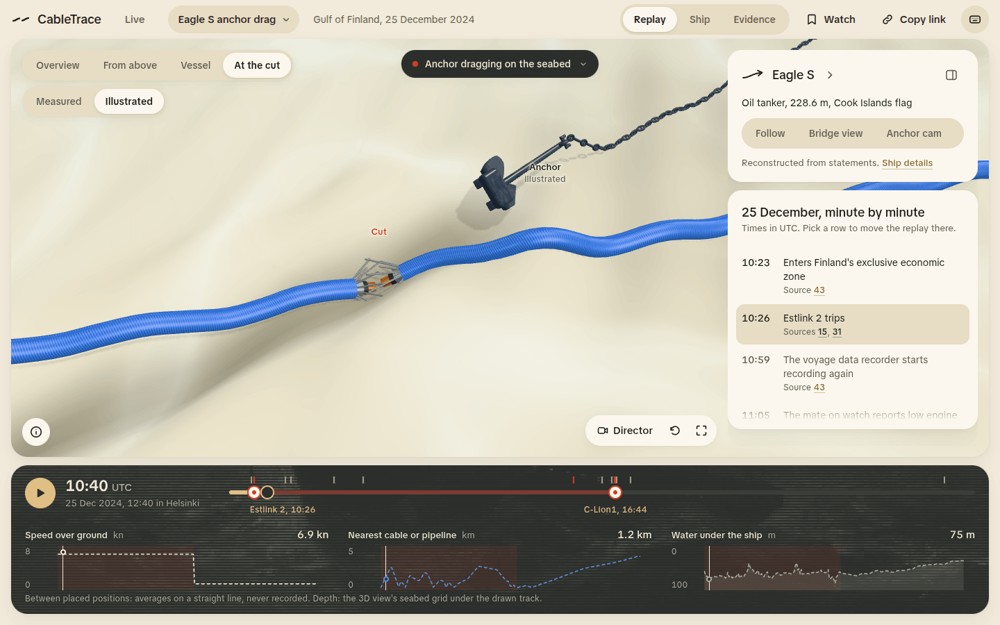
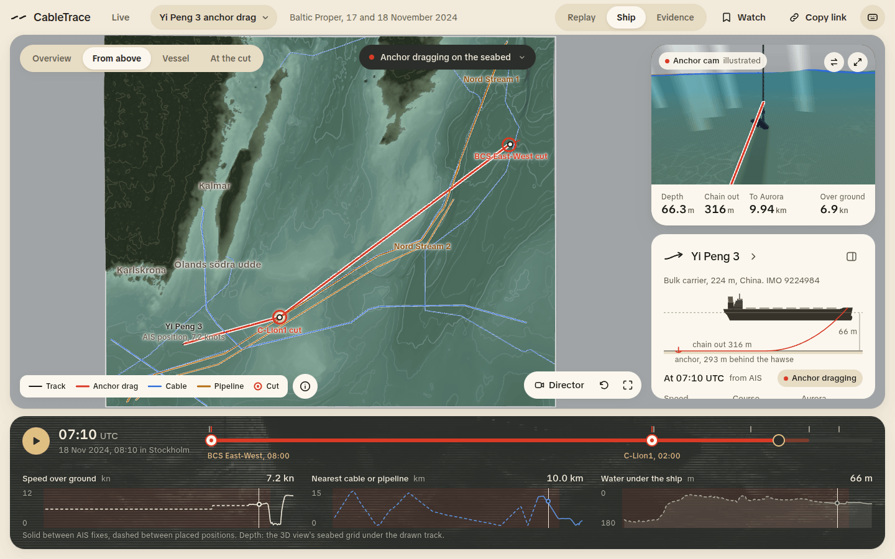
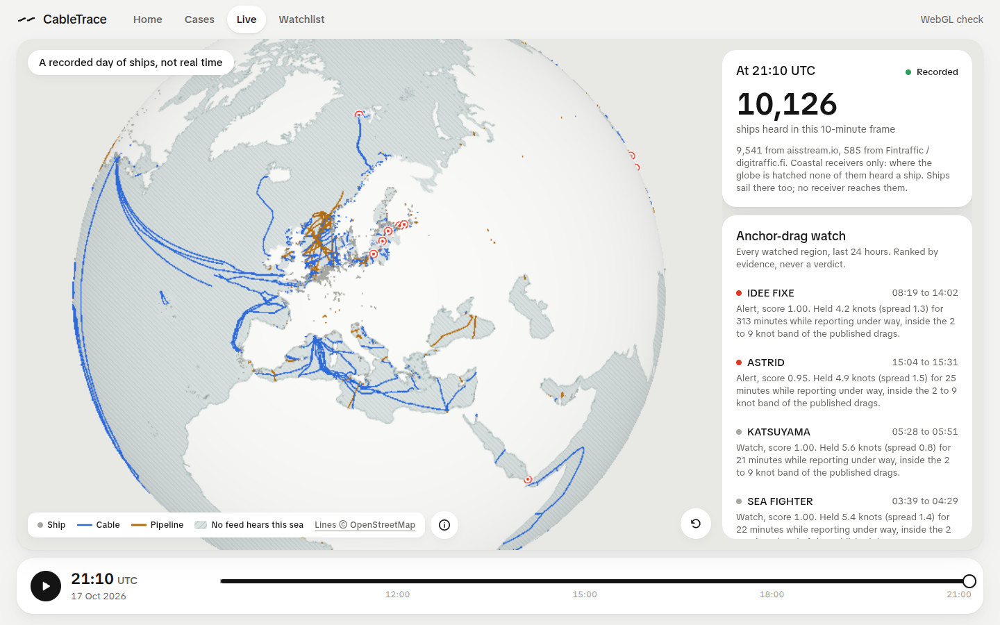
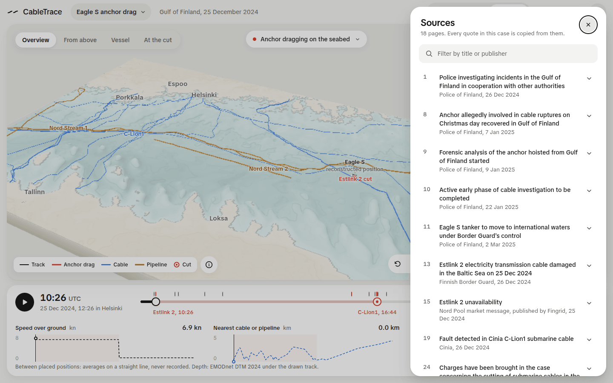
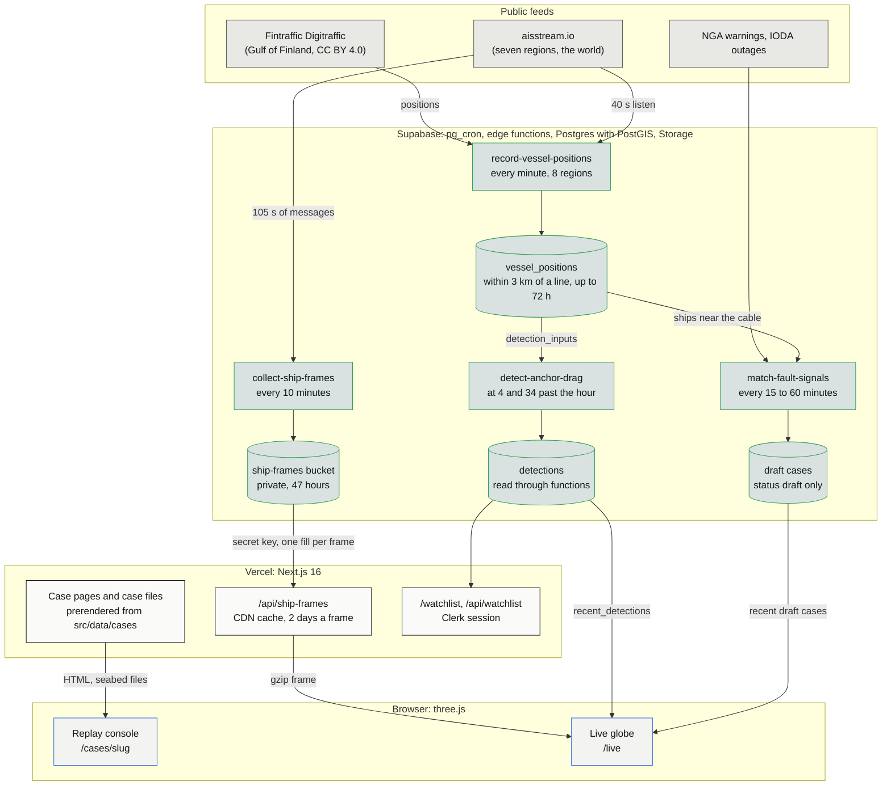

<p align="center">
  
</p>
<h1 align="center">CableTrace</h1>
<p align="center">
  Subsea cable cuts by ships, replayed in 3D from the published record. Every placed position states how it was
  derived, every event links to a verbatim quote from its source, and every case downloads as a file whose SHA-256
  anyone can recompute.
</p>
<p align="center">Built for the TestSprite Hackathon Season 4, Project Track. Live at <a href="https://cabletrace.vercel.app">cabletrace.vercel.app</a>: the front page is public, and "Continue with Google" (or a code by email) opens the console. Anyone can create an account.</p>

<p align="center">
  
  
  
  
  
  
</p>



| At the cut (illustrated close-up)                                       | Ship mode on Yi Peng 3's recorded AIS                              |
| ----------------------------------------------------------------------- | ------------------------------------------------------------------ |
|  |  |

| A recorded day of the world's ships (`/live`)                           | Every quote copied from a source                                   |
| ----------------------------------------------------------------------- | ------------------------------------------------------------------ |
|  |  |

## 🎯 The problem

The ten incidents replayed here, from Svalbard in January 2022 to the Matsu Islands in March 2026, put 16 cable and
pipeline cuts on file in the Baltic, the Taiwan Strait, the Red Sea and off Svalbard. In most of them a ship was
on the spot when the line failed. Each time, the facts arrive in pieces: police statements, operator notices,
prosecutors' releases, court rulings, a MarineTraffic screenshot in a news story, sometimes a day of public AIS.
Readers get a map with a red line and no way to tell which part is measured and which is a guess.

The usual answer is a news graphic. It is drawn once, cites nobody line by line, and cannot be checked or reused.
CableTrace treats each incident as evidence: every position, time and claim carries its source and says how it is
known, the gap between "recorded" and "reconstructed" stays visible on screen, and a probable finding is labelled as
one.

## 🧰 What it does

- **Replays ten incidents in 3D.** In the Baltic: Fitburg (2025), Vezhen (2025), Eagle S (2024), Yi Peng 3 (2024) and
  Newnew Polar Bear (2023). In the Taiwan Strait: Hai Hong Gong 66 (2026), Minlianyu 60138 (2025) and Hong Tai 58 (2025). Rubymar
  in the Red Sea (2024) and the Svalbard cable fault (2022). Each sits on a seabed block built from EMODnet depth
  (Europe) or the GEBCO 2026 grid (Taiwan, Red Sea) and Copernicus land heights, drawn at an exaggeration that fits its
  depth: 20 times in the Baltic, 2 times off Svalbard. Each ship is built to its real length from a hull generator for
  its type (nine kinds, from trawler to tanker), its anchor hangs on a catenary chain and drags behind it, and the cut
  breaks its cable at the time the sources give. A browser with a real WebGPU adapter gets a WebGPU renderer with
  ambient occlusion in the relief and under the cable and anchor; every other browser keeps WebGL, and headless test
  browsers a software tier.
- **Says how every position is known.** A placed position carries a `placement` text (`src/data/cases/*.ts`): "the
  point 130 km along the mapped route from its Ventspils end, the distance LVRTC gives". Recorded AIS fixes (Svalbard:
  235 of the trawler's own reports from the Norwegian Coastal Administration; Yi Peng 3: 114 from the Danish Maritime
  Authority archive; Vezhen: 35) are drawn solid, placed stretches dashed.
- **Cites every claim verbatim.** 127 sources across the ten cases, 113 with a Wayback Machine copy; a quote not in
  English keeps a translation beside the original. Rubymar's cause is labelled a probable finding on every event.
- **Exports each case as a checkable file.** `/cases/<slug>/case-file` serves the case as JSON with the SHA-256 of its
  canonical form; `scripts/cases/verify-case-file.ts` recomputes it.
- **Watches eight regions.** A recorder stores every ship within 3 km of one of 336 cables and pipelines once a
  minute: Fintraffic Digitraffic in the Gulf of Finland, a 40 s aisstream.io listen in the Central Baltic, the Danish
  straits, the English Channel, the North Sea off Shetland, Norway and Svalbard, the Taiwan Strait and Perth. Every 30
  minutes an anchor-drag detector ranks the last 6 hours of tracks by evidence, with each region's depth grid, and
  writes `detections`.
- **Opens draft cases from fault signals.** `match-fault-signals` polls NGA navigational warnings and IODA internet
  outage alerts, matches each signal to a recorded cable and lists the ships recorded near it before the fault, ranked
  by the detector. Every draft says "Draft case", never a finding (`docs/FAULT_SIGNALS.md`).
- **Keeps a watchlist.** Signed-in readers (Clerk) watch a ship, a cable or a case; `/watchlist` lists the detector's
  alerts on them from the last 24 hours.
- **Shows a recorded day of the world's ships.** Every 10 minutes a collector writes one compressed frame of every ship
  aisstream.io and Digitraffic heard; `/live` plays the last 24 hours on a globe with the world's submarine cables and
  pipelines (4,186 OpenStreetMap lines), hatches the sea no receiver heard, lists the ships that crossed a clicked
  line, and dives from a cut on the globe into its case. It zooms by sea, not by land: from orbit a dot per 220 km
  cell sized by its ships and the busiest of 104 named seas counted; a sea's own ships and the watched regions in it;
  a region up close; the picked ship. The tier and the centre stay in the address.

## 🧭 How it works



Gray: outside feeds. Green outline: Supabase. Black outline: Vercel. Blue outline: the browser.

The cases are data in the repository, so a case page needs nothing at run time: Vercel prerenders it, and the
browser loads the seabed block and draws it. Everything live runs on Supabase's free plan and on pg_cron, with no
server of its own. Recorder tables, detections, drafts and watch items have no public read: the site reads them
through capped functions or with the secret key on the server. When a run fails, the failure shows rather than hides:

- The live card on the landing page says "Last run failed" or "Behind by N min", and "as of" the time it last read.
- A collector run that writes no frame leaves a gap in the `/live` timeline, one tick per stored frame.
- A frame that cannot be loaded puts a notice on the globe, and the last good pair stays on screen.
- A depth grid the detector cannot load is logged and skipped; ships outside every grid get the unknown-depth band.
- A browser without WebGL 2 gets "The 3D view did not load" and a retry. On a software renderer (headless test
  browsers) both 3D views drop antialiasing and shadows, draw at a lower pixel ratio and only when something changes.

### The anchor-drag detector

The detector (`src/lib/detection`) is shared by the edge function, the backtest and the tests. It never accuses: each
rule returns the numbers it measured and one sentence a reader can check against them. Thresholds and their sources
are in `src/lib/detection/drag-rules.ts`.

| Rule                  | Fires when                                                                 | Drawn from                                                                 |
| --------------------- | -------------------------------------------------------------------------- | -------------------------------------------------------------------------- |
| `low-speed-under-way` | 20 minutes or more at 2 to 9 knots, status under way, speed spread under 2 kn | Yi Peng 3 dragged at 7.2 to 7.7 kn (DMA archive); Eagle S at 7.7 to 8.6 kn |
| `straight-run`        | the run covers 3 km or more at a straightness of 0.9 or better             | both published drags followed their passage line                           |
| `speed-deficit`       | 20% or more slower than the ship's own speed before or after               | Eagle S 25%; Yi Peng 3 27% (DMA archive) and 33% (Lloyd's List)            |
| `speed-change-point`  | a drop of 1.5 kn or more where the run starts                              | a quarter of the 6 to 9 kn band                                            |
| `heading-offset`      | heading turns 2 degrees or more away from course during the run            | Yi Peng 3: +0.7 against -1.4 degrees, a 2.1 degree shift                   |
| `cable-contact`       | the reconstructed anchor path crosses a cable, or follows one within 500 m for 2 km | anchor behind the ship by the chain length for its size (IACS UR A1) and the depth under it |

An alert needs the strong form of the speed deficit and a straight run; anything weaker stays a watch. Pilot boats,
tugs, dredgers and other working craft (AIS ship types 30 to 34, 36, 37, 50 to 55 and 58) are not eligible.

## 🔗 Live and evidence

| What                         | Where                                                                                     |
| ---------------------------- | ----------------------------------------------------------------------------------------- |
| The app (public front page)  | [cabletrace.vercel.app](https://cabletrace.vercel.app)                                    |
| Sign in (Google or an email code; every link below needs it, except health) | [/sign-in](https://cabletrace.vercel.app/sign-in) |
| A replay                     | [/cases/eagle-s-2024](https://cabletrace.vercel.app/cases/eagle-s-2024)                   |
| A replay from the trawler's own AIS | [/cases/svalbard-2022](https://cabletrace.vercel.app/cases/svalbard-2022)          |
| A deep link (minute, view, card) | [/cases/yi-peng-3-2024?t=2024-11-18T07:10Z&mode=ship&view=top](https://cabletrace.vercel.app/cases/yi-peng-3-2024?t=2024-11-18T07:10Z&mode=ship&view=top) |
| A case file                  | [/cases/eagle-s-2024/case-file](https://cabletrace.vercel.app/cases/eagle-s-2024/case-file) |
| The recorded day             | [/live](https://cabletrace.vercel.app/live)                                               |
| Health of the recorder and collector | [/api/health](https://cabletrace.vercel.app/api/health)                           |
| WebGL check of your browser  | [/diagnostics](https://cabletrace.vercel.app/diagnostics)                                 |

Evidence:

- **A case file checks out.** `bun scripts/cases/verify-case-file.ts https://cabletrace.vercel.app/cases/eagle-s-2024/case-file`
  printed `computed 5e70b383...19b89`, `intact`, and exited 0 on 17 Oct 2026.
- **A changed file does not.** The same file with one latitude moved by 0.001 degrees printed
  `ALTERED, the hashes differ` and exited 1.
- **The detector flags the one drag with public AIS.** On Yi Peng 3's archive track (one report a minute) it raised an
  alert from the first surviving report, 06:01 UTC on 18 Nov 2024, ending at 08:21, 3 minutes before the published
  end (`bun scripts/backtest/run-backtest.ts`).
- **And says no to the red team.** 7 red-team tracks (a ship anchored beside a cable, a spoofed position jump, a tug
  towing across a cable) raised no alert.
- **But it is noisier than its target on live traffic.** Replayed on its live schedule over 18.8 hours of recorded Gulf
  of Finland traffic (923 ships, 68,181 positions on 17 Oct 2026), it raised 2 alerts: 2.55 a day against a target of
  under 1. The backtest reports this as the one failed expectation of 15 and exits 1; the thresholds were not moved to
  pass it.
- **The database filter loses nothing.** The live query sends only ships that can hold a drag run; on the same
  traffic it would have dropped 0 of 586 tracks the detector flagged.
- **The detector runs on all eight regions.** A manual run of the deployed function on 17 Oct 2026 read 237 ships with
  depth known and stored 45 detections: 1 alert in the Gulf of Finland and 44 watch-level rows.
- **Strangers read nothing raw.** An anonymous call to `detection_inputs` answers HTTP 401 (permission denied), and a
  watchlist read without a session is refused.
- **Every page fits one screen.** `bun scripts/perf/check-one-screen.ts` exits 0 for home, the case list, `/live`
  and all ten cases at 1440 x 900, 1280 x 720 and 1024 x 768; the 3D view covers 65.4% of a 1440 x 900 screen.
- **The 3D look is checked frame by frame.** `bun scripts/lookdev/run-lookdev.ts` renders 72 fixed frames on the
  software, WebGL GPU and WebGPU tiers (the WebGPU frames through Windows Chrome on a real adapter), compares them
  with baselines Andy approved on 18 Oct 2026 and samples the data colours: on both GPU tiers 102 of 104 cable probes
  and all 174 alarm probes land within 2 levels of their token (0 of 457 cable probes did before). When the GEBCO
  seabeds were smoothed and the two trawlers got fishing hulls, the software tier failed exactly the 9 frames those
  changes moved and passed the other 15 (`docs/LOOKDEV.md`).
- **Every source still answers.** `bun run check:sources` resolves all 127 sources and their 119 archived copies (all
  live); the 8 that cannot be archived (multi-gigabyte AIS zips, an API query, pages that refuse archiving) are listed
  with their reasons. Its first run caught a moved Danish AIS file and an archive of the wrong page, both fixed.
- **Nothing is buried, and the keyboard works.** `bun run check:evidence` searches every path of up to two clicks or
  keys for each source, quote, translation, placement note and credit; `bun run check:keyboard` opens and closes every
  layer with Tab, Enter and Esc. Their first runs caught quotes three clicks deep and three dialogs that dropped
  focus on close; both are fixed, and all 976 items of the ten cases are now within two (`docs/EVIDENCE_CHECKS.md`). `bun run check:links` reopens 89 shared links across
  the ten cases at the right minute, view and card.

## 🧪 Reproduce it

Prerequisites: [Bun](https://bun.sh) 1.4.3 (`packageManager` in `package.json`) and Node.js 22 for the Next.js CLI.

```bash
git clone https://github.com/Andy00L/cabletrace.git
cd cabletrace
bun install
bun run dev
```

Open http://localhost:3000. The ten replays, the case files and the WebGL check work with no configuration: their
data is in the repository. The recorder card and `/live` need a Supabase project with the migrations in
`supabase/migrations`, and `NEXT_PUBLIC_SUPABASE_URL`, `NEXT_PUBLIC_SUPABASE_PUBLISHABLE_KEY` and
`SUPABASE_SECRET_KEY` in `.env.local`; without them the card reads "Unavailable" and `/live` says the day could not be
loaded. The watchlist also needs a Clerk application (`NEXT_PUBLIC_CLERK_PUBLISHABLE_KEY`, `CLERK_SECRET_KEY`).

The checks a pull request passes:

```bash
bun run typecheck
bun run lint
bun test src
bun run build
```

Success: each exits 0; `bun test src` runs 359 tests.

Check a case file (it touches nothing). Download it from a case's Case file row while signed in, then:

```bash
bun scripts/cases/verify-case-file.ts ~/Downloads/cabletrace-eagle-s-2024.json
```

Success: the recorded and computed hashes print equal, then `intact`, exit 0.

The one-screen check needs a production build running (`bun run build && bun run start`) and a Chromium
(`--chromium <path>` or `PERF_CHROMIUM_PATH`):

```bash
bun scripts/perf/check-one-screen.ts http://localhost:3000
```

The backtest reads the recorded traffic of the CableTrace Supabase project with SELECT statements only, through the
Management API; it needs that project's `SUPABASE_ACCESS_TOKEN` and `SUPABASE_PROJECT_REF`, refuses any other project,
and exits 2 without them. Today it exits 1: 14 of its 15 expectations hold (see above).

## ⚠️ What is real and what is reconstructed

- **Most past ship positions are reconstructed.** No free archive holds most suspect ships' AIS at the moment of a
  cut. Eagle S, Fitburg, Newnew Polar Bear, Rubymar and the three Taiwan cases are placed from statements, court
  records and published maps; Yi Peng 3 and Vezhen partly. Each placed position says how it was derived, the replay
  labels it "reconstructed position", and its stretch of track is dashed. The charts say when a speed is a
  straight-line average between placed positions. Svalbard is the one replay built entirely from the ship's own AIS.
- **Not every case names a culprit.** Rubymar's anchor is the cause the US National Security Council called "most
  likely", so every Rubymar event says probable. Norwegian police closed the Svalbard case as no criminal offence; the
  replay shows the trawler's track and never says it cut the cable. Rubymar's cut positions are read off a map in
  Meta's engineers' slides, and its cables are not drawn because no licensable route map exists.
- **The close-up is illustrated.** The anchor, chain, cable armour and torn ends at the cut are drawn to show what
  happens, labeled "illustrated"; the Measured switch shows only the surveyed seabed. Depth and land are drawn larger
  than life by a factor each area picks from its relief (20 and 10 in the Baltic, 10 and 3 in the Red Sea, 2 and 2
  off Svalbard), ships too, and the scale note under the view states that area's numbers
  (`src/lib/seabed/scene-scales.ts`). The overview draws ships 6 times their size, so an anchor at its true layback,
  about 300 m behind the hawse, can look as if it lies under the hull. The GEBCO seabeds are smoothed for drawing
  only; the depth chart reads the grid as published.
- **`/live` is a recorded day, not real time.** Frames are 10 minutes apart and a ship moves in a straight line between
  two reports. aisstream.io is terrestrial AIS: the globe hatches the sea no receiver heard, and the page says so.
  aisstream publishes no terms, so its data is kept 2 days and credited.
- **The detector's quiet record is short and not yet met.** On 18.8 hours of Gulf traffic it raised 2.55 alerts a day
  against a target of under 1 (IDEE FIXE ran slow and straight for 5.5 hours, ASTRID for 39 minutes). Outside the Gulf its
  false-alert rate is untested; one 6-hour window gave 20 watch-level rows in the English Channel and North Sea. It
  cannot alert while a ship drags at its normal speed: on Yi Peng 3 the first live-schedule alert came 98 minutes after
  the drag ended, once the ship sped up. A ship with no reported dimensions falls back to a 120 to 300 m size band.
  The anchor model (IACS UR A1) gives Eagle S a 9.3 t anchor where the police statements say about 11 t.
- **Fault signals are thin.** NGA's warning feed has published nothing newer than 10 May 2024. IODA publishes no terms
  for redisplay, so a signal shows only its title and a link. ENTSO-E power-link outages wait for an API token.
- **Accounts run on Clerk's development instance.** A production instance needs a custom domain; the development tier
  allows 100 users, and the sign-in form says "Development mode".
- **The whole app sits behind sign-in.** Only the front page, the sign-in pages and `/api/health` are public, so a case
  file is downloaded signed in (the console's Case file row) and checked from the saved file.
- **The WebGPU tier was tested on one adapter.** It ran on an AMD GCN 5 laptop GPU through Windows Chrome; other GPUs
  and browsers fall back to WebGL when they offer no real adapter. Its code (199.5 KB compressed) loads only when the
  tier is chosen.
- **Not built:** Norway's own AIS feed (BarentsWatch), so Norway and Svalbard are heard through aisstream only.

## 🏆 TestSprite

The TestSprite GitHub App tests every pull request: when Vercel reports the pull request's preview ready, TestSprite
runs every portal test against that preview, reports the "TestSprite V3" check and comments its report. The 28
browser tests in `testsprite/plans` are the suite. Each plan asserts what a reader sees, through `data-testid`,
`data-state`, `aria-pressed` and `aria-current` hooks and the console's own wording, never pixel positions.

| Plan | Flow | What a regression there would break |
| --- | --- | --- |
| `console-01` | Front page, the list of cases, open the first | The way in: a case band that opens the wrong case or a 3D view that never loads |
| `console-02` | Case list grouped by region, open Yi Peng 3 | Region grouping, sketches, the track-evidence line on each card |
| `console-03` | Eagle S opens on its first position | The opening minute (10:26, not the window start), defaults, anchor status |
| `console-04` | Play and pause | The clock moving, Pause holding it, the anchor status matching the minute |
| `console-05` | Jump from the minute-by-minute list | Seeking, the current row (`aria-current="step"` on its item), `t` in the URL |
| `console-06` | Views, Measured and Illustrated, the scale note | The disclosure of how much larger than life each view is drawn |
| `console-07` | Evidence mode: placed positions, sources sheet, filter | The path from a position to its sources, links opening in a new tab |
| `console-08` | Case file row | The download link and the 12 shown characters of its full SHA-256 |
| `console-09` | Yi Peng 3, placed then recorded AIS over two days | Day labels, the "from AIS" or "derived" basis, the recorded stretch and its archive |
| `console-10` | Rubymar, a 12-day window with three cuts | Cut labels on a long timeline, the cut card, Go to the close-up |
| `console-12` | Shared links | A link restoring minute, view, mode and card; unknown values falling back |
| `console-13` | Vessel card, Follow, Ship details | The vessel's figures and basis, the Vessel view, the ship's identity |
| `console-14` | Keyboard shortcuts | Event jumps, view keys, Space to play and pause, the shortcuts dialog |
| `live-01` | Live globe, the Eagle S incident, Fly to the seabed | The recorded day loading, and the dive landing on the cut's minute and card |
| `live-02` | Feed check on `/live` | The verdict text matching its state, with the 90% and 95% targets |
| `live-03` | Zoom by sea: Planet, a sea, back up, a link to the Baltic, the Gulf of Finland | The busiest seas ranked, each tier's card, breadcrumb and address |
| `landing-01` | The front page signed out | The hero replay jumping to a picked moment, every case on file, the recorder's live figures and regions, with no account |
| `landing-02` | Open the console from the front page, sign in | The gate sending a reader to sign-in and back into the console |
| `account-01` | The sign-in page | Google first and an email code, the gate's own wording |
| `account-02` | A shared replay link, signed out | The link surviving sign-in, minute and card included |
| `account-03` | The watchlist signed in | The page opening for a reader with an account |
| `director-01` | The director on, a view picked, the Director button | The camera following the story until the reader takes it, and giving it back |
| `director-02` | Eagle S near the C-Lion1 cut | The clock slowing around the cut, the countdown, the cut to the close-up |
| `ship-01` | Vessel inspector on Yi Peng 3 at the C-Lion1 cut, then stowed | The side profile, chain out and layback, the derived figures and their basis |
| `ship-02` | Yi Peng 3's AIS signal strip and the timeline panel | 114 reports, the 15, 15 and 50 minute silences, the reconstructed stretch |
| `ship-03` | A ship with no AIS, and the vessel card's profile | The no-AIS state for Eagle S and the anchor chain in the vessel card |
| `diagnostics-01` | WebGL check from the header, Measure again | The map and 3D probes rendering, the renderer and frame timings |
| `routes-01` | `/api/health` signed out, then an unknown case signed in | The health contract and a 404 instead of a broken console |

Every plan signs in with its own Clerk test address, `testsprite-<plan>+clerk_test@example.com` (its code is always
424242 and no email is sent), before it opens an app page. Clerk limits verification code requests per address: with
one shared address, 2 to 4 of the 29 tests in a run that starts them together were blocked at sign-in.
`routes-01` reads `/api/health` signed out first. No plan depends on another, and each runs the same
before and after the app goes behind sign-in. Each plan's steps and assertions were run with Playwright against
cabletrace.vercel.app and against the sign-in gate's preview, at 1280 x 720: 20 of 20 passed on both. The newer ones were
walked the same way: `director-01` and `director-02` passed every step on production, `live-03` 7 of 7 checks on a
local build of its branch, and the landing and account plans on the gate's preview. `testsprite/backend` holds two API tests in TestSprite's Python
format: the health contract, and the sign-in gate (only the front page and `/api/health` answer a signed-out caller,
the APIs refuse it with 401, the pages redirect toward sign-in). Both pass with `python3 testsprite/backend/<file>.py`
against the live app and wait for a TestSprite backend project, since this one is a frontend project. A manual run against any URL is `.github/workflows/testsprite.yml`,
started from the Actions tab.

## 📚 Data sources and licences

| Data                         | Source                                                                                  | Licence                       |
| ---------------------------- | --------------------------------------------------------------------------------------- | ----------------------------- |
| Water depth, Europe          | EMODnet Bathymetry Consortium, EMODnet Digital Bathymetry (DTM 2024)                     | CC BY 4.0                     |
| Water depth, Taiwan and Red Sea | GEBCO Compilation Group (2026) GEBCO 2026 Grid (doi:10.5285/4f68d5c7-45eb-f999-e063-7086abc036fa) | public domain |
| Land heights and coast       | Copernicus DEM GLO-30, produced using Copernicus WorldDEM-30 (c) DLR e.V. 2010-2014 and (c) Airbus Defence and Space GmbH 2014-2018, provided under COPERNICUS by the European Union and ESA | Copernicus DEM licence, free with attribution |
| Cables, seabed blocks and globe | OpenStreetMap contributors; EE-S1 traced off a Yle map (yle.fi/a/74-20056160); TP3 placed from Taiwan's Ministry of Digital Affairs and Coast Guard statements | ODbL 1.0; the derived files (`public/globe/cables.json`, the lines in `public/seabed/*-seabed.json`) are offered under ODbL 1.0 |
| Pipelines                    | EMODnet Human Activities                                                                | CC BY 4.0                     |
| Globe land                   | Natural Earth 1:50m                                                                     | public domain                 |
| Named seas on the globe      | Natural Earth 1:50m marine areas, drawn into `public/globe/seas.json` by `scripts/globe/build-seas.ts` | public domain                 |
| Sand ripple detail (GPU tier) | Poly Haven, Aerial Beach 01 by Rob Tuytel                                              | CC0                           |
| Recorded AIS, Yi Peng 3 and Vezhen | Danish Maritime Authority AIS archive (aisdata.ais.dk)                            | DMA terms for the archive     |
| Recorded AIS, Svalbard       | Norwegian Coastal Administration, Kystdatahuset                                         | NLOD                          |
| Live Gulf of Finland positions | Fintraffic, digitraffic.fi                                                            | CC BY 4.0                     |
| Live positions, other regions and the globe | aisstream.io                                             | no terms published; kept 2 days, credited |
| Flags from MMSI              | ITU, Maritime Identification Digits table (read 17 Oct 2026)                             | facts, credited               |
| Fault signals                | NGA Maritime Safety Information broadcast warnings; IODA (Georgia Tech) outage alerts   | US government work; IODA shown as title and link only |
| Case statements and quotes   | 127 primary and press sources, listed per case in the app and in each case file         | quoted for reporting          |

The Copernicus licence asks for this sentence with modified data: the organisations in charge of the Copernicus
programme by law or by delegation do not incur any liability for any use of the Copernicus WorldDEM-30.

## 🧩 Prior art

- **[MarineTraffic](https://www.marinetraffic.com) and [VesselFinder](https://www.vesselfinder.com)** show live and past
  positions; they do not reconstruct incidents, cite sources line by line or separate measured from placed positions.
- **[Global Fishing Watch](https://globalfishingwatch.org)** publishes open AIS analytics with careful method notes,
  for fishing activity rather than damage to seabed infrastructure.
- **[TeleGeography's Submarine Cable Map](https://www.submarinecablemap.com)** maps cable routes; its data is not openly
  licensed, so CableTrace draws OpenStreetMap and EMODnet routes instead.

## 📦 Repository layout

```
docs/               design system, performance, regions, fault signals, README assets
public/             seabed blocks (depth grid and lines per area), globe land and world lines
scripts/            seabed, land and globe builders, AIS extraction, backtest, fault-signal replay, perf checks, case file check
src/app/            pages and route handlers (cases, case files, /live, /watchlist, sign-in, /api)
src/components/     console, live globe, cases, watchlist, layout, shared UI
src/data/cases/     the ten cases: positions, events, cuts, sources, AIS fixes
src/data/regions/   the eight watched regions: boxes, feeds, recording thresholds, incidents
src/lib/            case model, detection, fault signals, regions, watchlist, globe, live frames, seabed and 3D scenes
supabase/           edge functions (recorder, detector, collector, fault-signal matcher) and migrations
testsprite/         TestSprite test plans
```
