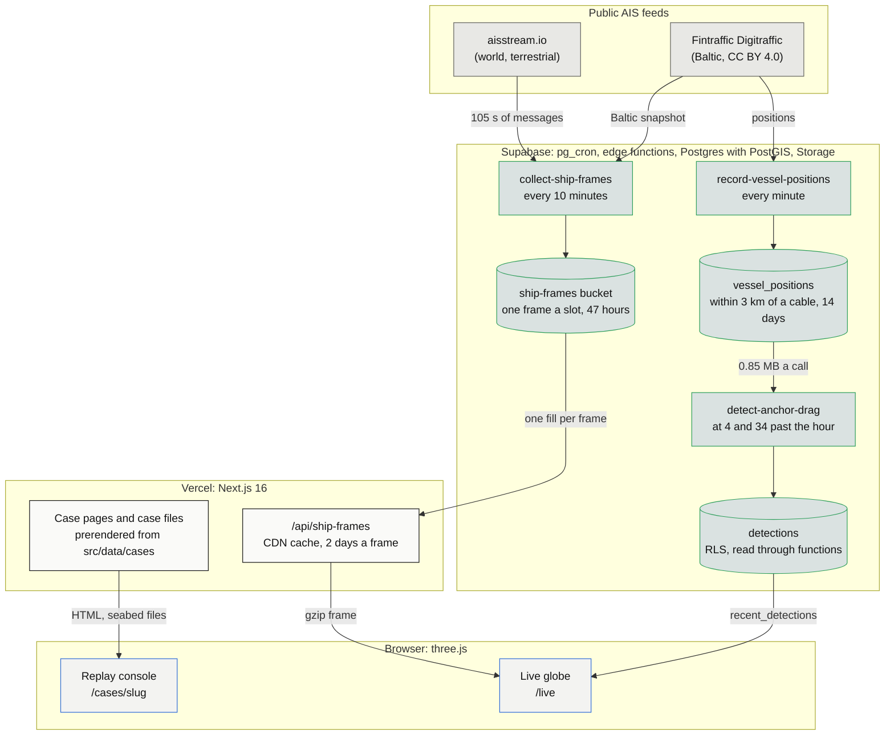

<p align="center">
  
</p>
<h1 align="center">CableTrace</h1>
<p align="center">
  The Baltic's anchor-drag cable cuts, replayed in 3D from the published record. Every placed position states how it
  was derived, every event links to a verbatim quote from its source, and every case downloads as a file whose
  SHA-256 anyone can recompute.
</p>
<p align="center">Built for the TestSprite Hackathon Season 4, Project Track. Live at <a href="https://cabletrace.vercel.app">cabletrace.vercel.app</a>.</p>

<p align="center">
  
  
  
  
  
</p>


| At the cut (illustrated close-up)                                       | Ship mode on Yi Peng 3's recorded AIS                              |
| ----------------------------------------------------------------------- | ------------------------------------------------------------------ |
|  |  |

| A recorded day of the world's ships (`/live`)                           | Every quote copied from a source                                   |
| ----------------------------------------------------------------------- | ------------------------------------------------------------------ |
|  |  |

## 🎯 The problem

Between October 2023 and December 2025, the five incidents replayed here damaged seven Baltic cables and one gas
pipeline, each time by a merchant ship that sailed on while its anchor dragged along the seabed. Each time, the facts arrive in pieces:
police statements, operator notices, prosecutors' releases, a MarineTraffic screenshot in a news story, sometimes a
day of public AIS. Readers get a map with a red line and no way to tell which part is measured and which is a guess.

The usual answer is a news graphic. It is drawn once, cites nobody line by line, and cannot be checked or reused.
CableTrace treats each incident as evidence: every position, time and claim carries its source and says how it is
known, and the gap between "recorded" and "reconstructed" stays visible on screen.

## 🧰 What it does

- **Replays five incidents in 3D.** Fitburg (31 Dec 2025), Vezhen (26 Jan 2025), Eagle S (25 Dec 2024), Yi Peng 3
  (17 and 18 Nov 2024) and Newnew Polar Bear (7 and 8 Oct 2023), each on a seabed block built from EMODnet depth and
  Copernicus land heights, with the cables and pipelines of the area. The anchor drag turns the track red; each cut
  breaks its cable at the time the sources give.
- **Says how every position is known.** A placed position carries a `placement` text (`src/data/cases/*.ts`): "the
  point 130 km along the mapped route from its Ventspils end, the distance LVRTC gives". Recorded AIS fixes (Yi Peng 3:
  114 from the Danish Maritime Authority archive; Vezhen: 35) are drawn solid, placed stretches dashed.
- **Cites every claim verbatim.** 88 sources across the five cases, 78 with a Wayback Machine copy; a quote not in
  English keeps a translation beside the original.
- **Exports each case as a checkable file.** `/cases/<slug>/case-file` serves the case as JSON with the SHA-256 of its
  canonical form; `scripts/cases/verify-case-file.ts` recomputes it.
- **Watches the Gulf of Finland.** A recorder stores every ship within 3 km of a cable once a minute (Fintraffic
  Digitraffic). Every 30 minutes an anchor-drag detector ranks the last 6 hours of tracks by evidence and writes
  `detections`; `/live` lists them.
- **Shows a recorded day of the world's ships.** Every 10 minutes a collector writes one compressed frame of every ship
  aisstream.io and Digitraffic heard; `/live` plays the last 24 hours on a globe, each ship moving between frames on
  the GPU.

## 🧭 How it works



Gray: outside feeds. Green outline: Supabase. Black outline: Vercel. Blue outline: the browser.

The cases are data in the repository, so a case page needs nothing at run time: Vercel prerenders it, and the
browser loads the seabed block and draws it. Everything live runs on Supabase's free plan and on pg_cron, with no
server of its own. When a run fails, the failure shows rather than hides:

- The recorder card on the home page says "Run failed" or "Stopped" with the minutes since the last run.
- A collector run that writes no frame leaves a gap in the `/live` timeline, one tick per stored frame.
- A frame that cannot be loaded puts a notice on the globe, and the last good pair stays on screen.
- A browser without WebGL 2 gets "The 3D view did not load" and a retry. On a software renderer (headless test
  browsers) both 3D views drop antialiasing and shadows, draw at a lower pixel ratio and only when something changes.

### The anchor-drag detector

The detector (`src/lib/detection`) is shared by the edge function, the backtest and the tests. It never accuses: each
rule returns the numbers it measured and one sentence a reader can check against them. Thresholds and their sources
are in `src/lib/detection/drag-rules.ts`.

| Rule                  | Fires when                                                                 | Drawn from                                                                 |
| --------------------- | -------------------------------------------------------------------------- | -------------------------------------------------------------------------- |
| `low-speed-under-way` | 20 minutes or more at 2 to 9 knots, status under way, speed spread under 2 kn | Yi Peng 3 dragged at 7.2 to 7.7 kn (DMA archive); Eagle S at 7.7 to 8.6 kn |
| `straight-run`        | the run covers 3 km or more at a straightness of 0.9 or better             | both published drags followed their passage line                           |
| `speed-deficit`       | 20% or more slower than the ship's own speed before or after               | Eagle S 25%; Yi Peng 3 27% (DMA archive) and 33% (Lloyd's List)            |
| `speed-change-point`  | a drop of 1.5 kn or more where the run starts                              | a quarter of the 6 to 9 kn band                                            |
| `heading-offset`      | heading turns 2 degrees or more away from course during the run            | Yi Peng 3: +0.7 against -1.4 degrees, a 2.1 degree shift                   |
| `cable-contact`       | the reconstructed anchor path crosses a cable, or follows one within 500 m for 2 km | anchor behind the ship by the chain length for its size (IACS UR A1) and the depth |

An alert needs the strong form of the speed deficit and a straight run; anything weaker stays a watch. Pilot boats,
tugs, dredgers and other working craft (AIS ship types 30 to 34, 36, 37, 50 to 55 and 58) are not eligible.

## 🔗 Live and evidence

| What                         | Where                                                                                     |
| ---------------------------- | ----------------------------------------------------------------------------------------- |
| The app                      | [cabletrace.vercel.app](https://cabletrace.vercel.app)                                    |
| A replay                     | [/cases/eagle-s-2024](https://cabletrace.vercel.app/cases/eagle-s-2024)                   |
| A deep link (minute, view, card) | [/cases/yi-peng-3-2024?t=2024-11-18T07:10Z&mode=ship&view=top](https://cabletrace.vercel.app/cases/yi-peng-3-2024?t=2024-11-18T07:10Z&mode=ship&view=top) |
| A case file                  | [/cases/eagle-s-2024/case-file](https://cabletrace.vercel.app/cases/eagle-s-2024/case-file) |
| The recorded day             | [/live](https://cabletrace.vercel.app/live)                                               |
| WebGL check of your browser  | [/diagnostics](https://cabletrace.vercel.app/diagnostics)                                 |

Evidence:

- **A case file checks out.** `bun scripts/cases/verify-case-file.ts https://cabletrace.vercel.app/cases/eagle-s-2024/case-file`
  printed `computed 2e549bfe...db518`, `intact`, and exited 0 on 17 Oct 2026.
- **A changed file does not.** The same file with one latitude moved by 0.001 degrees printed
  `ALTERED, the hashes differ` and exited 1.
- **The detector flags the one drag with public AIS.** On Yi Peng 3's archive track (one report a minute) it raised an
  alert from the first surviving report, 06:01 UTC on 18 Nov 2024, ending at 08:21, 3 minutes before the published
  end (`bun scripts/backtest/run-backtest.ts`, 15 of 15 expectations).
- **And stays quiet on ordinary traffic.** Replayed on its live schedule over 7.4 hours of recorded Gulf of Finland
  traffic (240 ships, 27,336 positions), it raised 0 alerts; 7 red-team tracks (a ship anchored beside a cable, a
  spoofed position jump, a tug towing across a cable) raised none.
- **The database filter loses nothing.** The live query sends only ships that can hold a drag run; on the same
  traffic it would have dropped 0 of 194 tracks the detector flagged.
- **Every page fits one screen.** `bun scripts/perf/check-one-screen.ts` exits 0 for home, the case list, `/live`
  and all five cases at 1440 x 900, 1280 x 720 and 1024 x 768; the 3D view covers 65.4% of a 1440 x 900 screen.

## 🧪 Reproduce it

Prerequisites: [Bun](https://bun.sh) 1.4.3 (`packageManager` in `package.json`) and Node.js 22 for the Next.js CLI.

```bash
git clone https://github.com/Andy00L/cabletrace.git
cd cabletrace
bun install
bun run dev
```

Open http://localhost:3000. The five replays, the case files and the WebGL check work with no configuration: their
data is in the repository. The recorder card and `/live` need a Supabase project with the migrations in
`supabase/migrations`, and `NEXT_PUBLIC_SUPABASE_URL` and `NEXT_PUBLIC_SUPABASE_PUBLISHABLE_KEY` in `.env.local`;
without them the card reads "Unavailable" and `/live` says the day could not be loaded.

The checks a pull request passes:

```bash
bun run typecheck
bun run lint
bun test src
bun run build
```

Success: each exits 0; `bun test src` runs 156 tests.

Check a case file from the live site (it touches nothing):

```bash
bun scripts/cases/verify-case-file.ts https://cabletrace.vercel.app/cases/eagle-s-2024/case-file
```

Success: the recorded and computed hashes print equal, then `intact`, exit 0.

The one-screen check needs a production build running (`bun run build && bun run start`) and a Chromium
(`--chromium <path>` or `PERF_CHROMIUM_PATH`):

```bash
bun scripts/perf/check-one-screen.ts http://localhost:3000
```

The backtest reads the recorded traffic of the CableTrace Supabase project with SELECT statements only, through the
Management API; it needs that project's `SUPABASE_ACCESS_TOKEN` and `SUPABASE_PROJECT_REF`, refuses any other project,
and exits 2 without them.

## ⚠️ What is real and what is reconstructed

- **Most past ship positions are reconstructed.** No free archive holds any suspect ship's AIS at the moment of a cut.
  Eagle S, Fitburg and Newnew Polar Bear are placed entirely from statements and published maps, Yi Peng 3 and Vezhen
  partly. Each placed position says how it was derived, the replay labels it "reconstructed position", and its
  stretch of track is dashed. The charts say when a speed is a straight-line average between placed positions.
- **The close-up is illustrated.** The anchor, chain, cable armour and torn ends at the cut are drawn to show what
  happens, labeled "illustrated"; the Measured switch shows only the surveyed seabed. Water depth is drawn 20 times
  deeper and ships larger than life, and the scale note under the view says by how much
  (`src/lib/seabed/scene-scales.ts`). Every ship uses one 228 m hull; Fitburg is 132 m and Newnew Polar Bear 169 m.
- **`/live` is a recorded day, not real time.** Frames are 10 minutes apart and a ship moves in a straight line between
  two reports. aisstream.io is terrestrial AIS: open ocean looks empty because no receiver hears it, and the page
  says so. aisstream publishes no terms, so its data is kept 2 days and credited.
- **The detector's quiet record is short.** Its false-alert rate comes from 7.4 hours of recorded traffic, and some
  thresholds were set while looking at those hours; the rate on later days is the honest test and the backtest
  replays up to 7. It cannot alert while a ship drags at its normal speed: on Yi Peng 3 the first alert came 98
  minutes after the drag ended, once the ship sped up. The live table has no ship dimensions yet, so the anchor model
  falls back to a 120 to 300 m size band.
- **Not built:** fault signals (outage notices opening draft cases), sign-in and watchlists, more watched regions than
  the Gulf of Finland, and the WebGPU renderer tier.

## 🏆 TestSprite

The TestSprite suite and its GitHub pull request check go live once TestSprite enables the account for this
project. Until then, the replay flows written so far are in `testsprite/plans`: 7 plans covering opening a case from
home, play and pause, jumping from the event list, views and the scale note, sources and placement, the mixed AIS and
reconstructed track, and the case list. Screens expose stable `data-testid` and `data-state` hooks for them, such as
`replay-console`, `seabed-view` (loading, ready, failed), `replay-scrubber`, `live-globe` and `download-case-file`.

## 📚 Data sources and licences

| Data                         | Source                                                                                  | Licence                       |
| ---------------------------- | --------------------------------------------------------------------------------------- | ----------------------------- |
| Water depth                  | EMODnet Bathymetry Consortium, EMODnet Digital Bathymetry (DTM 2024)                     | CC BY 4.0                     |
| Land heights and coast       | Copernicus DEM GLO-30, produced using Copernicus WorldDEM-30 (c) DLR e.V. 2010-2014 and (c) Airbus Defence and Space GmbH 2014-2018, provided under COPERNICUS by the European Union and ESA | Copernicus DEM licence, free with attribution |
| Cables                       | OpenStreetMap contributors; EE-S1 traced off a Yle map (yle.fi/a/74-20056160)           | ODbL                          |
| Pipelines                    | EMODnet Human Activities                                                                | CC BY 4.0                     |
| Globe land                   | Natural Earth 1:50m                                                                     | public domain                 |
| Recorded AIS in two cases    | Danish Maritime Authority AIS archive (aisdata.ais.dk)                                  | DMA terms for the archive     |
| Live Baltic positions        | Fintraffic, digitraffic.fi                                                              | CC BY 4.0                     |
| Live world positions         | aisstream.io                                                                            | no terms published; kept 2 days, credited |
| Case statements and quotes   | 88 primary and press sources, listed per case in the app and in each case file          | quoted for reporting          |

The Copernicus licence asks for this sentence with modified data: the organisations in charge of the Copernicus
programme by law or by delegation do not incur any liability for any use of the Copernicus WorldDEM-30.

## 🧩 Prior art

- **[MarineTraffic](https://www.marinetraffic.com) and [VesselFinder](https://www.vesselfinder.com)** show live and past
  positions; they do not reconstruct incidents, cite sources line by line or separate measured from placed positions.
- **[Global Fishing Watch](https://globalfishingwatch.org)** publishes open AIS analytics with careful method notes,
  for fishing activity rather than damage to seabed infrastructure.
- **[TeleGeography's Submarine Cable Map](https://www.submarinecablemap.com)** maps cable routes; its data is not openly
  licensed, so CableTrace draws OpenStreetMap and EMODnet routes instead.

## 📦 Repository layout

```
docs/             design system, performance numbers, README assets
public/           seabed blocks (depth grid and lines per area), globe land
scripts/          seabed and land builders, AIS extraction, backtest, perf checks, case file check
src/app/          pages and route handlers (cases, case files, /live, /api)
src/components/   console, live globe, cases, layout, shared UI
src/data/cases/   the five cases: positions, events, cuts, sources, AIS fixes
src/lib/          case model, detection, globe, live frames, seabed and 3D scenes
supabase/         edge functions (recorder, detector, collector) and migrations
testsprite/       TestSprite test plans
```
